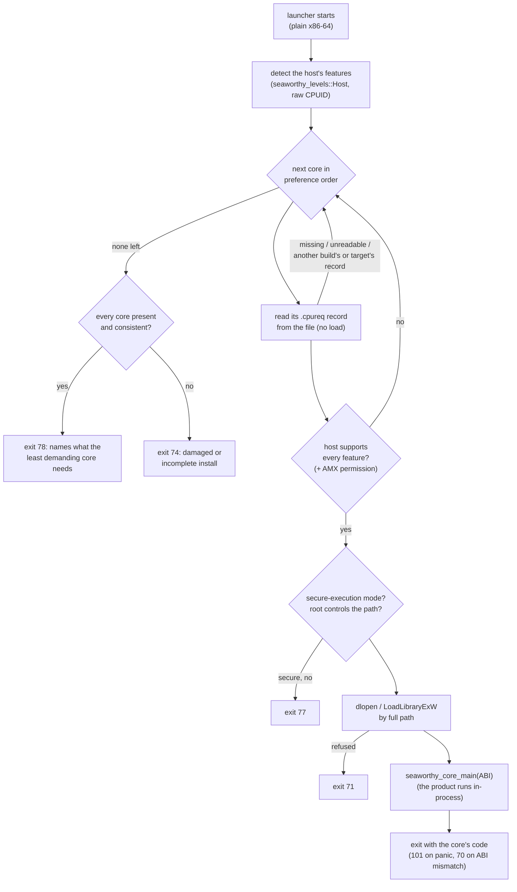

# seaworthy-launcher

*The best build this CPU can run — chosen before a single instruction of it executes.*

## What it is / how it works / where it's needed

`seaworthy-launcher` is a thin launcher that loads the best per-CPU build
of a product. A product ships a **launcher** — a small executable built for
its architecture's baseline (plain x86-64; `apple-m1` on Apple Silicon) —
and one **core** per CPU target: the product's real code built as a shared
library with `-C target-cpu=<cpu>` (`x86-64-v4`, `x86-64-v3`, `x86-64-v2`
by default; `apple-m1` on macOS). At startup the launcher reads each core's
requirement record **from the file, without loading it**
(`seaworthy-levels`), skips every core the host can't fully run, loads the
first one in the product's preference order that it can, and calls it.
Everything then runs in one process: `std::env::args_os()`, signals, the
Windows service dispatcher and systemd behave exactly as in a normal
executable, and `current_exe()` is the launcher's real installed path.

Wrappers such as cargo-multivers' runner pick a build at runtime and then
**write it to disk and execute it** (`%TEMP%` on Windows, a memfd on Linux)
— the pattern security products flag, and a real weakness when an elevated
process loads DLLs from a user-writable directory. Here nothing is written
or extracted at runtime: every image is a file the OS installer put in a
directory only administrators can write.

How levels are chosen, how a product builds one core per level and how the
launcher falls back is in [`docs/cpu-levels.md`](../../docs/cpu-levels.md).

## The rules of seaworthy-launcher

1. **A core is loaded only when the host supports every feature it was
   compiled with.** The record lists exactly what the compiler enabled
   (`--print cfg` for the core's own target and flags, plus what the CPU
   target uses without `--print cfg` reporting it — `apxf` for
   `diamondrapids` and `novalake`); an unknown feature name refuses the
   core (`seaworthy-levels`' rule 1); the first core in order that passes
   is loaded. Every core present and none passes → exit 78, naming what
   the least demanding core needs.
2. **The record describes the core, or the core doesn't build.** The build
   script refuses `-C target-feature=+name` for a name no record can carry
   (APX's `+nf`, `+ndd`, … reach LLVM unreported), and any enabled feature
   without a `seaworthy-levels` row. It reads the flags as rustc does: every
   spelling of the option (`-C x`, `-Cx`, `--codegen x`, `--codegen=x`,
   `target_feature` as well as `target-feature`) and `@argfile` arguments,
   expanded (an argfile must be named by an absolute path). `core_main!` checks at compile time
   that the core crate was compiled with the same CPU flags as the build
   script saw — flags given to the core crate alone (`cargo rustc -- -C
   target-cpu=…`) fail the build, naming the first feature they disagree
   on.
3. **Records are read, never executed.** A core's record is parsed out of
   its file; nothing of a core runs — not even its initializers — until it
   has been chosen.
4. **Cores load by full path, from the launcher's own directory only.**
   Linux: `dlopen(<dir>/lib/lib<core>_<cpu>.so, RTLD_NOW | RTLD_LOCAL)`.
   Windows: `LoadLibraryExW(<dir>\<core>_<cpu>.dll,
   LOAD_LIBRARY_SEARCH_DLL_LOAD_DIR | LOAD_LIBRARY_SEARCH_SYSTEM32)`, so the
   core's own imports (for example the AWS-LC FIPS DLL pair) resolve from
   the same directory and System32 — never the working directory or
   `PATH`. macOS: `dlopen(<App>.app/Contents/Frameworks/lib<core>_<cpu>.dylib,
   RTLD_NOW | RTLD_LOCAL)`, the launcher in `Contents/MacOS`, its own path
   resolved first (macOS reports the path a program was started by: a
   symlink stays a symlink). **In secure-execution mode** (Linux
   `AT_SECURE`: a set-user-ID, set-group-ID or file-capability launcher;
   macOS `issetugid()`) a core is opened only if root controls every step
   of its resolved path — the file a regular file, it and every directory
   up to `/` owned by root and not writable by group or others — checked
   for every core before its record is read; it is opened without
   following a symlink or blocking (`O_NOFOLLOW | O_NONBLOCK`), must be a
   regular file on the open descriptor, and the resolved path is what is
   loaded; otherwise exit 77. A hardlink to such a
   launcher in a user's own directory would otherwise load that user's
   "core" with the launcher's privileges.
5. **One process, one ABI.** The launcher calls the core's exported
   `seaworthy_core_main(abi)`; the core refuses another ABI version (exit
   70) and contains its own panics (exit 101), so no unwind ever crosses
   the C boundary. The core's stdout buffer (the core links its own copy
   of std) is flushed when its `main` returns.
6. **A missing core is damage, never "CPU too old".** If any core is
   missing, unreadable, or carries another build's or another target's
   record, and nothing loadable remains, the launcher exits 74 and lists
   every core — the missing one may be exactly the one this CPU needs.
7. **A Linux launcher or core keeps to the glibc floor its builder can
   keep.** `core_main!` and `launcher_main!` invoke `glibc_floor!`, which
   binds libm's `hypot` and `hypotf` to glibc's baseline versions
   (`GLIBC_2.2.5`): glibc 2.35 versioned both anew, so without it any
   binary calling `f64::hypot` (egui does) linked on a Debian 12 builder
   (glibc 2.36) would need 2.35 and refuse to start on RHEL 9 (2.34).
   Weak, hidden stubs: nothing exported (a launcher would otherwise
   interpose libm for the whole process); never invoke it beside those
   macros (twice in one crate the assembler refuses it). A release
   pipeline should still refuse any other symbol version past its floor.

## TL;DR — reach for this when… / not when…

- **When** a product benefits from per-CPU builds (wide vector code,
  `x86-64-v3`/`v4` speedups) and still has to run on older hardware.
- **When** you need one installed layout that keeps working when a disk,
  VM or golden image moves to different hardware — the choice is made at
  every start.
- **Not when** the hardware is known (server containers): ship one binary
  built for that CPU.

## Deliberately out of scope

- **Packaging and layout.** A packaging tool builds the cores, names them,
  lays the tree out and signs it; the launcher only consumes that layout.
- **Verifying signatures.** The launcher trusts the files in its own
  directory: integrity comes from the OS installer placing signed files in
  an administrator-only directory (Authenticode on every PE file, package
  signatures on Linux). A launcher that verified its own cores would still
  trust the launcher.
- **Relaunching on failure.** A core that exits is the process exiting;
  services restart through the SCM's failure actions and systemd.
- **aarch64 off macOS, and Intel Macs.** aarch64 features are detected
  through macOS's `sysctl` only (Linux aarch64 detects nothing, so no core
  loads); an Intel Mac would need Darwin's lazy AVX-512 state handled (not
  planned).

## Capabilities

- `launcher_main!` — a product launcher's `main` (its CPU list, embedded in
  a `.cpulist` section for a packaging tool to cross-check).
- `core_main!` — a core's exported entry point with the ABI check, the
  panic boundary and the stdout flush, plus the compile-time check that the
  core crate saw the build script's CPU flags; `CoreExit` adapts `()`,
  `i32`, `u8`, `Result<(), E>`.
- `this_core()`, `record()` — the running core's CPU name and requirement
  record (startup logs, telemetry).
- `core_path`, `run`, `Launcher` — the layout rule and the launcher entry.
- `glibc_floor!` — the glibc floor stubs, for another binary shipped beside
  the launcher (an update helper).
- The build script — writes the core's `.cpureq` record for each target
  build, and refuses flags no record could describe.
- Overrides: `SEAWORTHY_CORE`, `SEAWORTHY_LAUNCHER_DEBUG`, ignored in a
  privileged process: secure-execution mode, root on Linux and macOS
  (`sudo`, a root shell, a root service), an elevated process on Windows
  (an administrator's elevated token, LocalSystem, the service accounts).
- On Windows the launcher's first act is
  `SetDefaultDllDirectories(LOAD_LIBRARY_SEARCH_DEFAULT_DIRS)`: every later
  `LoadLibrary` in the process, the core's included, searches the
  launcher's directory, System32 and `AddDllDirectory` directories only,
  never the working directory or `PATH`. A core that loads libraries from
  `PATH` opts out with `legacy_dll_search = true` in `launcher_main!`. The
  seaworthy CLI's build plan also links the launcher with
  `/DEPENDENTLOADFLAG:0xA00`, so its own imports skip the working
  directory and `PATH` too (a product building its launcher otherwise
  adds `cargo:rustc-link-arg-bins=/DEPENDENTLOADFLAG:0xA00` to the
  launcher crate's build script, MSVC targets only: a dependency's build
  script can't pass a link argument to the product's binary).
- Everything the launcher prints, and its macOS alert, shows control
  characters and invisible or bidirectional formatting characters escaped
  (`\u{202E}`): a file name can't forge a line or reorder a message.
- On macOS, a launcher started by LaunchServices (the Finder, the Dock,
  `open`: no terminal) also shows its own failures in an alert
  (CoreFoundation's `CFUserNotificationDisplayAlert`); a core's failures
  are the core's to report.
- `EXIT_*` — documented exit codes (below).

## Architecture diagram



## Examples

The launcher crate (a `bin`, built **without** any target CPU):

```rust,ignore
// launcher/src/main.rs
seaworthy_launcher::launcher_main!(
    core = "tool_core",
    cpus = ["x86-64-v4", "x86-64-v3", "x86-64-v2"],
);
```

The core crate (a `cdylib` holding the product), built once per CPU:

```rust,ignore
// core/src/lib.rs   ([lib] crate-type = ["cdylib"])
fn main() -> Result<(), tool::Error> {
    tracing::info!(core = seaworthy_launcher::this_core(), "starting");
    tool::run()
}
seaworthy_launcher::core_main!(main);
```

Both macros work in a crate that forbids unsafe code
(`#![forbid(unsafe_code)]`).

Complete wiring — the build and layout a packaging tool performs (shown so
the contract is explicit; the fixture under `e2e/` is exactly this):

```sh
# The launcher: plain x86-64.
cargo build --release --target x86_64-unknown-linux-gnu -p tool_launcher
# One core per CPU, each in its own target directory, `-C target-cpu` only.
for cpu in x86-64-v4 x86-64-v3 x86-64-v2; do
  RUSTFLAGS="-C target-cpu=$cpu" CARGO_TARGET_DIR="target/core-$cpu" \
    cargo build --release --target x86_64-unknown-linux-gnu -p tool_core
  install -D "target/core-$cpu/x86_64-unknown-linux-gnu/release/libtool_core.so" \
    "/opt/acme/tool/lib/libtool_core_$cpu.so"
done
install -D target/x86_64-unknown-linux-gnu/release/tool_launcher /opt/acme/tool/tool
```

## Wiring it in

- **Manifest** — both the launcher crate and the core crate depend on
  `seaworthy-launcher = "0.1"`; the core's manifest sets
  `[lib] crate-type = ["cdylib"]`.
- **Server boot** — no server wiring. A service's core calls its normal
  service runtime from its `main`; the SCM and systemd see the launcher's
  process.
- **Client** — nothing beyond the two macros.
- **What it injects** — a `.cpureq` section into every core (the build
  script's record) and a `.cpulist` section into the launcher; the exported
  symbol `seaworthy_core_main`; reads `SEAWORTHY_CORE` and
  `SEAWORTHY_LAUNCHER_DEBUG`.
- **Configuration surface** — the macro arguments (`core`, `cpus`); the two
  environment overrides; the layout rule (`core_path`).

## Proper usage by circumstance

- **Building cores:** one target directory per CPU, `-C target-cpu=<cpu>`
  and nothing else CPU-related, and always `--target <triple>`.
  **Warning:** without `--target`, cargo applies `RUSTFLAGS` to build
  scripts and proc-macros too — a build script compiled for `x86-64-v4`
  crashes with an invalid opcode on a build host without AVX-512.
  **Warning:** building every CPU in one target directory rebuilds over the
  previous core; each core's record then still matches its own binary, but
  the files you copy out race the next build — keep the directories apart.
  `-C target-feature=…` (other than `+crt-static`) makes the build script
  warn: the record still lists exactly what the compiler enabled, but the
  core no longer matches its CPU name. Enabling a name `seaworthy-levels`
  has no row for (`+nf`, `+egpr`, any LLVM-only feature) fails the build.
  **Warning:** set the CPU where every crate sees it — `RUSTFLAGS`,
  `CARGO_ENCODED_RUSTFLAGS` or `[target.<triple>] rustflags` — never
  `cargo rustc -- -C target-cpu=…`, which reaches the core crate alone:
  `core_main!` fails that build (the record would describe the default
  CPU). Its check sees the features stable rustc exposes to `cfg!`; two CPU
  targets differing only in unstable features would slip past it — one
  more reason to set the CPU in one place.
  `-C target-cpu=native` builds (with a warning) but the launcher refuses
  the result: its record names `native`, not one of the product's CPUs.
- **Panics:** a core built with `panic = "abort"` aborts on a panic
  (`SIGABRT`, 134 from a shell on Linux; `0xC0000409` on Windows) instead
  of exiting 101 — the panic never reaches the launcher's boundary. Either
  is fine for a service manager; scripts that test for 101 need unwinding.
- **Installing:** only to a directory administrators alone can write
  (`%ProgramFiles%\<vendor>\<product>`, `/opt/<vendor>/<product>`).
  **Warning:** a user-writable install directory lets anyone with that
  user's rights replace a core — the launcher loads whatever file carries a
  matching record; the protected directory and the installer's signatures
  are the integrity boundary. The record is read and the library loaded by
  path, two steps apart (a check-then-use window): only someone who can
  already write the install directory can swap a file in between, and
  that someone can replace the core outright, so the window adds nothing
  to their power. Updates replace cores by atomic rename, and every build
  of one CPU target carries the same requirements, so an update landing
  mid-start loads a consistent core. (Loading through the descriptor the
  record was read from, `dlopen("/proc/self/fd/N")`, would close the
  window but break `$ORIGIN` lookups and name every frame of a backtrace
  `/proc/self/fd/N`; not worth it for a window that grants nothing.)
  **Set-user-ID or file-capability launchers** are supported but not
  recommended (services run as their service account instead); when used,
  the secure-execution trust rule (rule 4) applies.
- **Supporting a machine:** `SEAWORTHY_LAUNCHER_DEBUG=1` prints the host's
  features and every decision; `SEAWORTHY_CORE=<cpu>` forces a core the
  host supports (anything else fails loudly: exit 64 for an unknown name,
  78 for an unsupported one). Both are ignored in secure-execution mode
  (`AT_SECURE`, `issetugid()`).
- **Apple Silicon:** ship `apple-m1`. Every arm64 Mac has the M1's
  features, so its core always loads; a core for a later chip carries
  `v8.5a` or later, which macOS reports no signal for, so the launcher
  skips it (`seaworthy-levels`' aarch64 rules) and falls back.
- **Virtual machines:** QEMU/KVM's default `qemu64` CPU model lacks the
  `x86-64-v2` floor (no POPCNT, SSE4.x) — the launcher exits 78 and says so;
  give the VM a newer model or `host`.
- **Running it locally:** a plain `cargo run` of the launcher exits 74,
  because no core sits beside it yet. Build one core for your machine's
  level (`x86-64-v2` runs anywhere) with `--target` and that one flag, and
  put it where the launcher looks (`core_path`): on Linux
  `target/debug/lib/lib<core>_x86-64-v2.so`, on Windows
  `<core>_x86-64-v2.dll` beside the launcher.

### Exit codes

| Code | Meaning |
| --- | --- |
| the core's | The product ran and exited with this code |
| 64 | `SEAWORTHY_CORE` names a CPU that isn't one of the product's builds |
| 70 | The core speaks another launcher ABI, has no entry point, or the launcher's own CPU list is inconsistent |
| 71 | The OS refused to load the chosen core (a missing DLL or shared library beside it, or a TLS failure) |
| 74 | Nothing loadable and the install is damaged or incomplete: a core is missing, unreadable, or carries another build's or another target's record — repair the install |
| 77 | Secure-execution mode (Linux `AT_SECURE`, macOS `issetugid()`): root does not control the chosen core's path (owner or permissions of the file or a directory above it) |
| 78 | Every core is present and this CPU runs none of them; the message names what the least demanding one needs |
| 101 | The core panicked (a core built with `panic = "abort"` aborts instead: `SIGABRT` / `0xC0000409`) |

## FAQ

**Why a shared library per CPU instead of one binary with runtime
dispatch?** CPU-level builds of the same program differ almost everywhere:
built at baseline and at `x86-64-v3`, a third of all functions change size,
holding 76% of the code bytes in a measured product. Runtime dispatch would
have to cover all of it, and delta-compressed embedded builds (a wrapper's
approach) stay large (about 4.5 compressed builds for 8 targets) — and
still need writing to disk to execute.

**Does `-C target-cpu` change the FIPS module?** No. The AWS-LC FIPS
module's C and assembler flags are identical in every core; its objects are
byte-identical once debug info is stripped. On Linux it links statically
into each core and its integrity self-test runs when the core is loaded,
before any product code. On Windows one copy of the module's DLL pair sits
beside the cores.

**Why does a Windows build's record not mention `crt-static`?**
`-C target-feature=+crt-static` (cargo-xwin and static-CRT Windows builds)
shows up in `--print cfg` as a `target_feature`, but it is not a CPU
feature. A record listing it would name a feature the launcher can't check
— which refuses the core on every machine — so the build script leaves it
out (`scripts/launcher-e2e.sh` checks a cargo-xwin core's record).

**Why does `diamondrapids` need `apxf` in its record when `--print cfg`
doesn't list it?** LLVM 22 turns on APX's sub-features (NF, NDD, CCMP,
PUSH2/POP2, …) for that CPU without the extended-GPR feature rustc reports
as `apxf`, so cfg is silent while the code carries EVEX-promoted
instructions that fault without APX. `seaworthy_levels::IMPLIED_FEATURES`
records the gap, the build script adds it to the record, and
`seaworthy-levels`' vocabulary test compiles a probe for every CPU target
so a toolchain upgrade that widens the gap fails the pipeline.

**Why does a core need `glibc_floor!` when it is built on Debian 12?**
Because "built on glibc 2.36, needs nothing past 2.34" is true of glibc's
C library but not of libm: glibc 2.35 gave `hypot` and `hypotf` new default
versions (it dropped their SVID error-handling wrappers), so a core calling
either needs `GLIBC_2.35`. glibc keeps the baseline versions for older
binaries (they are the only ones RHEL 9 has), so the macro's stubs
tail-call those: same results, no newer need. `scripts/launcher-e2e.sh`
checks each core's binding on the host's glibc and runs the call. A binary
that isn't a launcher or core (a product's update helper) can invoke
`seaworthy_launcher::glibc_floor!()` at its crate root.

**Why was my core refused for "initial-exec TLS"?** A core is a library
the launcher loads with `dlopen`, and code compiled for the initial-exec
TLS model (C libraries opt in for speed: mimalloc does by default) needs
its thread-locals in glibc's static TLS block, of which a library loaded
at run time gets only a small shared surplus. A core with a few kilobytes
of such thread-locals fails to load ("cannot allocate memory in static TLS
block", exit 71). Build the dependency with a dynamic TLS model (mimalloc:
`local_dynamic_tls`); a release pipeline should refuse any core flagged
`DF_STATIC_TLS`.

**Why exit 78, not a fallback to a baseline build?** The floor is the
product's choice (`x86-64-v2` by default). Below it, nothing it ships can
run; a clear message beats a crash in a code path days later.

## Compliance models

### HIPAA
No PHI and no HIPAA-relevant surface.

### SOC 2 Type 2
CC6.8 (prevent or detect unauthorized software): no code is written to disk
or executed from a user-writable location at runtime; cores load by full
path from the launcher's own directory with restricted DLL search. Evidence:
`scripts/launcher-e2e.sh` in the pipeline.

### FIPS
No cryptography in the launcher. A core may carry the AWS-LC FIPS module
(statically on Linux; the DLL pair beside the cores on Windows), and the
module's integrity self-test runs at load.

### PQ
No cryptographic surface.

## Platform notes

| Platform | Status |
| --- | --- |
| Linux x86-64 (glibc) | Supported: `dlopen`, `AT_SECURE` (overrides ignored, the path trust rule), the AMX permission (`arch_prctl`) |
| Windows x86-64 (MSVC) | Supported: `LoadLibraryExW` with restricted search; records checked through a cargo-xwin build (`scripts/launcher-e2e.sh`) |
| macOS, Apple Silicon | Supported: `dlopen` from the bundle's `Contents/Frameworks`, records in `__DATA,__cpureq`/`__DATA,__cpulist`, `sysctl` detection, `issetugid()` (overrides ignored, the path trust rule), the failure alert; end to end in `scripts/launcher-e2e-macos.sh` |
| Linux aarch64, Intel macOS | No |
| wasm | No — there is nothing to launch |

## Where it sits

Depends on `seaworthy-levels` (the tables, detection and records), `libc`
(Unix), `windows-sys` (Windows) and, on macOS, the CoreFoundation framework
(the failure alert). Products depend on it from their launcher and core
crates; a packaging tool lays out and verifies what it produces. Its
unsafe code is the loader FFI (`dlopen`/`dlsym`, `LoadLibraryExW`/
`GetProcAddress`), the secure-execution and AMX queries, the record's link
section and the macOS alert — each block allowed locally with its safety
argument.

## See also

[`seaworthy-levels`](../seaworthy-levels/README.md) ·
[`docs/cpu-levels.md`](../../docs/cpu-levels.md) · `e2e/`,
`scripts/launcher-e2e.sh` and `scripts/launcher-e2e-macos.sh` (the
end-to-end contract)
