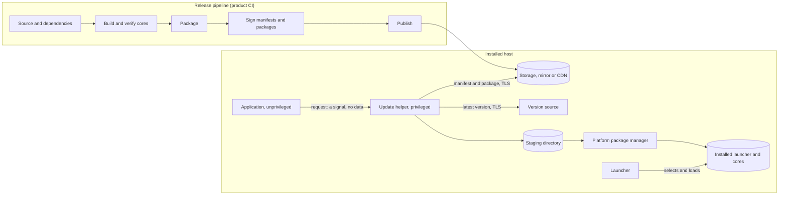

# Threat model

This document describes what seaworthy defends, against whom, where the trust boundaries are,
and which mechanism answers each threat. It also lists what seaworthy does **not** defend
against and the risks that remain. Report a weakness in any of this through
[SECURITY.md](../SECURITY.md).

**Status: pre-release.** The model covers the distribution stack as it is being extracted
(CPU-level builds and the launcher, packaging, signing, service definitions and the update
helper). It gets its formal review before the first release; items marked **Required before
1.0** are part of that release's acceptance criteria.

## Scope

| Component | What it does | Runs where, with which privileges |
|---|---|---|
| `seaworthy` (CLI) | Plans CPU-level builds, verifies binaries, packages (`.deb`, `.rpm`, Arch, MSI, `.pkg`, archives), signs release manifests and packages, builds signed repositories, publishes | The product's CI or a release machine, holding signing credentials |
| `seaworthy-formats` | The signed release manifest, release identifiers, the product model: the contract between the CLI and the updater | Both sides |
| `seaworthy-crypto` | Signatures (ML-DSA-87, ECDSA P-256, Ed25519), digests, constant-time comparison, randomness, the TLS client configuration, all on AWS-LC (optional FIPS module) | Everywhere |
| `seaworthy-updater` | The update request API, policy, the privileged update helper, per-platform installers, relaunch | The installed host: the application (unprivileged) and the helper (root / LocalSystem) |
| `seaworthy-service` | One service description rendered to systemd units, Windows services and launchd jobs, and the runtime glue | Build time (rendering) and the installed host (runtime) |
| `seaworthy-launcher`, `seaworthy-levels` | Picks and loads the best per-CPU core the machine can run; reads CPU requirement records | The installed host, as the invoking user |
| `seaworthy-fsguard` | The ownership and permission audits of administrator-owned folders and files (Windows owner, DACL and reparse points read by handle; Unix owner, mode and symlinks), with each caller's policy as a parameter | The installed host, inside the helper, the service and the launcher's install-time guard |
| This repository's CI | Tests, scans and releases seaworthy itself | GitHub-hosted runners |

## Assets

| ID | Asset | Why it matters |
|---|---|---|
| A1 | **Release signing keys** (manifest keys) and the public keys embedded in clients | Whoever signs with a trusted key controls what every client installs with administrator rights. |
| A2 | **Package-signing keys**: Authenticode certificates, OpenPGP keys for `.rpm`/pacman packages and repository metadata | They decide what operating systems and package managers accept outside the update helper. |
| A3 | **The update helper's privileges** (root, LocalSystem) | The helper installs software; misusing it is local privilege escalation. |
| A4 | **The staging directory** | It holds downloaded packages between verification and installation. |
| A5 | **Installed binaries**: the launcher, the per-CPU cores, the helper | They run with the user's or the service's privileges on every start. |
| A6 | **Update policy** (`auto` / `notify` / `off`, holds, the configured server) | Administrators rely on it to control change on their machines. |
| A7 | **The version source** (the product's update server, or a signed "latest" record) | It decides which release a client moves to. |
| A8 | **Build provenance** of seaworthy's own releases | Users verify downloaded CLI binaries against it. |

## Adversaries

| ID | Adversary | Capabilities assumed |
|---|---|---|
| T1 | **Network attacker** | Reads, drops, delays, replays and modifies traffic between clients and servers, including DNS. Cannot break TLS with a trusted certificate, or the signature schemes. |
| T2 | **Malicious mirror, CDN or storage operator** | Serves arbitrary bytes for any URL it hosts, old or new, or nothing at all. |
| T3 | **Local unprivileged user** | Runs code as a non-administrator on an installed host; can write their own files, `/tmp`, their environment; can try to race the helper. |
| T4 | **Compromised CI** | Controls a build job or a third-party action in a pipeline, with that job's permissions. |
| T5 | **Malicious pull-request author** | Submits arbitrary code and workflow changes to this repository and gets them run by pull-request CI. |
| T6 | **Compromised dependency** | Publishes a malicious version of a crate (or a build script) in seaworthy's or a product's graph. |
| T7 | **Compromised version source** | Controls the answers of the product's update server. |

The machine's administrator is trusted: an administrator can replace any binary, policy or key on
their own machine.

## Trust boundaries

| ID | Boundary | Crossed by | Rule |
|---|---|---|---|
| B1 | Network ↔ host | Version answers, manifests, packages | Nothing from the network is trusted until a signature by an embedded release key covers it, and nothing is parsed before that signature is checked, apart from the bounded envelope that carries it. |
| B2 | Application (user) ↔ update helper (admin) | The update request | The request carries no data. The helper decides everything from administrator-owned state and signed data. |
| B3 | Unprivileged filesystem ↔ administrator-owned paths | Policy files, staging, the helper's log, the service's state, install directories | Administrator-owned state is accepted only after an ownership and permission check of the object and every parent; anything a non-administrator could have written is ignored or refused. Where a lower-privileged account (a service's) may write a directory, nothing more privileged writes there. One crate makes these checks for the helper, the service and the launcher's guard (`seaworthy-fsguard`); each caller passes who besides the administrators may own and write, and which rights count as a write. |
| B4 | Helper ↔ package manager | The verified package | Exactly the verified file, by absolute tool path, without a shell, after a dry run that must plan exactly that package and version. |
| B5 | Launcher ↔ core | The selected core | Cores are loaded by full path from the launcher's own administrator-owned directory, after their requirement record was read without running them. |
| B6 | Release pipeline ↔ signing credentials | Signing operations | Credentials stay in the signer (a key file or an external command, e.g. an HSM or KMS); they never reach packaging tools: `seaworthy` removes the secrets `signing.toml` names from its environment and gives every tool it starts an allowlisted environment, and only signing commands see the runner's and the cloud's credentials. |
| B7 | Pull-request code ↔ this repository's privileged CI | Workflow runs | Pull-request jobs run with a read-only token, no secrets, and cannot write caches that privileged runs use. |
| B8 | Product code ↔ a release's signing jobs | Build outputs, `release.env`, build plans | Product code (its build scripts, its `build-metadata` command) runs only in jobs that hold no secret. The jobs that sign run no product code, build `seaworthy` themselves from seaworthy's own checkout (never a cache), run that checkout's scripts, and take only data from earlier jobs: binaries, which `verify` checks, and records read strictly. |

## Threats and mitigations

Each mitigation names the mechanism and where it lives. Module names refer to the crate in the
first column of [Scope](#scope) that owns the behavior.

### Release signing and the manifest

| Threat | Adversary | Mitigation |
|---|---|---|
| Forged or modified package | T1, T2 | Every package is installed only if a release manifest signed by an embedded key binds its exact size and digest (SHA-512 or SHA-256). Digests are compared in constant time (`seaworthy-crypto`). |
| Substitution of another genuinely signed release (another product, channel, platform, format or build) | T2, T7 | The signed statement binds product, channel, version **and** build, release sequence, target triple, package format, size and digest. The helper compares each with what it expects before installing (`seaworthy-formats` manifest; `seaworthy-updater` helper). |
| Parser attack on unsigned input | T1, T2 | The envelope is parsed strictly and bounded (at most 8 signatures, metadata capped at 64 KiB); the signature is verified over the canonical re-encoding of the statement before any field is used, and a statement that does not re-encode byte for byte is refused. The parsers have fuzz targets (`fuzz/`). |
| Cross-protocol signature reuse | T2 | Statements start with the domain-separation tag `seaworthy-release-manifest:1`; key identifiers hash `seaworthy-release-key:1:<algorithm>:` with the key and only select a key, never authenticate it. Text fields are length-prefixed. |
| Weak or malformed keys | T2, T4 | Keys under which anyone can forge are refused at load and again at every verification: small-order Ed25519 points, off-curve or compressed P-256 points, and ML-DSA-87 keys that seaworthy's intake test refuses. FIPS 204 defines no public-key validation, and many ML-DSA-87 keys verify a signature computed from public data (`c̃ = H(μ ‖ w1Encode(0))`, `z = 0`, `h = 0` verifies whenever `HighBits(−c·t1·2^d) = 0`: an all-zero `t1`, a single non-zero coefficient, every coefficient 512, and other structured keys). The intake test refuses all-zero, low-weight, low-entropy and periodic `t1` polynomials, then measures `HighBits(−c·t1·2^d)` under 128 fixed challenges and refuses a key that leaves too few coefficients non-zero (a genuine key is refused with probability below 2^-147). It refuses the known forgery classes and keys whose forgeability is measurable, but a key designed to collapse only under rare challenges cannot be ruled out: it is defense in depth. Trust only keys from your own `seaworthy keygen` or HSM, or from their holder over an authenticated channel; `release-trust = "every-algorithm"` makes one weak key insufficient. Each P-256 key has one identifier; the FIPS build refuses algorithms outside the module's approved set (`seaworthy-formats`, `seaworthy-crypto`). |
| Rollback to an older, vulnerable release | T1, T2, T7 | The helper compares (version, sequence) with the installed release: equal means nothing to do, older is refused unless the product explicitly allows downgrades (`seaworthy-updater` helper). The release side orders the same way: `repo` and `publish` refuse a release older by (version, sequence) than the one published (a maintenance 1.2.1 built after 1.3.0 included) unless `--allow-older` records a deliberate rollback (`seaworthy` repo, publish). |
| Key compromise | T4 | Clients embed a set of keys; by default any one valid signature from that set is accepted, so a key is rotated by shipping a release that trusts the new key, then signing with it. With `release-trust = "every-algorithm"` in `seaworthy.toml`, the helper requires a valid signature for every algorithm among its keys (for example ML-DSA-87 and Ed25519), so one stolen, weak or broken key is not enough; `HelperConfig::new` refuses a trust that ignores the setting. The release side signs with one key per configured algorithm and checks that every signing key is among the keys clients embed (`seaworthy` sign). See [Residual risks](#residual-risks) for what the default acceptance rule implies. |
| Signing-key theft from the release machine | T4, T6 | Local key files are refused when group- or world-readable (checked on the open file) and held in zeroizing buffers; an external signer (HSM/KMS command) runs without a shell, with a deadline and output caps; secret environment variables are removed from the process environment before anything runs, and every tool `seaworthy` starts (nFPM, strip, gpg, rpmsign, osslsigncode, WiX, msitools, the repository and macOS tools) gets an allowlisted environment with no `SEAWORTHY_*`, `ACTIONS_*`, `AZURE_*` or `AWS_*` variable, and the OpenPGP checks it shares with the update helper an even smaller one (`PATH`, `TZ`, `LC_ALL=C`, a throwaway home), so a credential under any other name doesn't reach them either; only the signing commands inherit the runner's and the cloud's credentials (`seaworthy` sign, process). In CI, `seaworthy.sh` takes every credential out of its environment as it starts and hands it to the `seaworthy` call alone, and the GitHub workflow makes its signing material for one step, in a private directory shredded when it ends (`scripts/ci/`). |

### Update transport

| Threat | Adversary | Mitigation |
|---|---|---|
| Plain-text interception | T1 | Only `https://` URLs, or `http://` to a loopback address, are accepted (`seaworthy-updater` net). |
| TLS downgrade or weak configuration | T1 | The TLS configuration comes from `seaworthy-crypto` only (AWS-LC provider, its protocol and group policy, the operating system's trust store through the platform verifier), enforced across the repository by `scripts/check-tls-construction.sh` and the cargo-deny ban on other TLS and crypto stacks. |
| Redirect to an attacker-chosen host (SSRF-like) | T1, T2 | Redirects are refused by default; a 3xx response is an error, never a body. An optional exact-host allowlist keeps a 10-hop limit and never leaves HTTPS (`seaworthy-updater` net). |
| Resource exhaustion through oversized or endless responses | T1, T2 | A package must be exactly the size the manifest states (at most 1 GiB): a disagreeing `Content-Length` is refused up front and the stream stops at the stated size; metadata is capped at 64 KiB; connect, metadata, download and probe timeouts apply (`seaworthy-updater` net). |
| Malicious version answer | T7 | Version tokens are 1–128 characters of `[A-Za-z0-9._+-]` without `..`; the server URL itself is compiled in or set by an administrator (`https`, a host, no credentials, query or fragment, at most 2048 bytes); a server chosen by a user downgrades the application to `notify` (`seaworthy-updater` policy). A version answer can only point at releases that carry valid signatures. |
| Information leaks in errors | T1, T3 | URLs (which may carry tokens) are stripped from error messages (`seaworthy-updater` net). |

### The update helper and the request path

| Threat | Adversary | Mitigation |
|---|---|---|
| Privilege escalation through the request | T3 | The helper takes no input from the application: arguments are ignored and a request is only a signal (a request file truncated with `O_NOFOLLOW`, a launchd `WatchPaths` touch, a Windows `StartService`, or, for desktop Linux, a polkit rule allowing exactly `systemctl start --no-block` of that one unit for an active local session). Interactive users get start and query rights on the Windows helper service, nothing more (`seaworthy-updater` helper). |
| Running the helper unprivileged or in an unexpected context | T3 | It runs only as a service (a root systemd oneshot started by a `.path` unit, a root LaunchDaemon, a LocalSystem service) and refuses to run without administrator rights. It is never setuid (`seaworthy-updater` helper). |
| Request flooding | T3 | Runs are at least 30 s apart and each run is bounded by an overall timeout; after a failure, a persisted backoff (one minute doubling to six hours, with jitter) paces retries of the same version (`seaworthy-updater` memo). |
| Race between verification and installation | T3 | The installed version is re-read after the download and before installing; staged files are verified and installed through descriptors the helper created (see Staging). |
| Abuse of the package manager | T3, T2 | Tools are run by absolute path, without a shell, with `--` before file and package arguments, under `LC_ALL=C`, with deadlines, process-group termination and output caps; the OpenPGP checks (gpg, rpmkeys) and `pacman-conf` start with an allowlisted environment (`PATH`, `TZ`, `LC_ALL=C` and the names a caller adds; a throwaway `HOME` and `GNUPGHOME` for the checks, so no home configuration such as `~/.rpmmacros` applies); tool output is stripped of control characters before it is logged. A dry run must plan exactly the product's package at the release's version (`apt-get -s`, `rpm -qp`, `pacman -Up --print-format`); `dnf` installs with all repositories disabled; installs run in a transient unit so a timeout never kills a package manager mid-transaction (`seaworthy-updater` installers). |
| Package-manager signature bypass | T2 | Where a product pins package-signing keys, `.rpm` and pacman signatures are checked against the compiled-in keys only, in a throw-away keyring or database; the pacman signature is placed before the install plan is computed, and only when pacman requires it (`seaworthy-updater` openpgp, pacman configuration). |
| Hijacked relaunch | T3 | The application is relaunched only when the installed release changed, from the launcher path captured before the update (Linux) or by a watcher started from `System32` with quoted, control-character-free values (Windows); the outcome reaches the new process in `SEAWORTHY_UPDATE_RESULT` (`seaworthy-updater` relaunch). |

### Update policy

| Threat | Adversary | Mitigation |
|---|---|---|
| A user forcing updates on, off, or to another server | T3 | Policy is read from administrator-owned sources only: Windows Group Policy, then the installer's machine key; on Linux, package-manager holds (`apt-mark`, `dnf versionlock`, pacman `IgnorePkg` as `pacman-conf` resolves it), then `/etc/<vendor>/<product>/policy.toml`, then the product default (`seaworthy-updater` policy). |
| Planting a policy file in a writable path | T3 | Anything a non-administrator could have written counts as `off`: the file and every parent up to `/etc` must be root-owned, not group- or world-writable and not a symbolic link, and the walk runs even when the file is missing; on Windows the owner and every write-capable ACL entry of each key must be SYSTEM, Administrators or TrustedInstaller. A policy that does not parse is `off` (`seaworthy-updater` policy). |

### The staging directory

| Threat | Adversary | Mitigation |
|---|---|---|
| Symlink or hard-link attacks, file squatting | T3 | The directory (`/var/cache/<vendor>/<product>` with systemd `CacheDirectory=`, mode 0700 and `UMask=0077`; `/Library/Application Support/…` on macOS; `%ProgramData%\<Vendor>\…\updates` located through the known-folder API, not the environment, on Windows) must be administrator-owned, 0700, with every parent administrator-owned, not group- or world-writable and not a link or reparse point (`seaworthy-updater` staging). |
| Swapping a file between verification and installation | T3 | Downloads go to a new random name opened with `O_CREAT | O_EXCL | O_NOFOLLOW`, mode 0600 (`CREATE_NEW` with restricted sharing on Windows); the file is hashed and its format checked through the same descriptor, then renamed into place (`seaworthy-updater` staging). |
| Feeding the package manager a different file type | T2 | The staged file's leading bytes must match the expected format (`.deb` `ar` archive, `.rpm` lead, zstd, zip, MSI compound file, xar) (`seaworthy-updater` format check). |
| Concurrent runs, leftovers | T3 | A lock on a regular, non-link file serializes runs; leftovers are swept under the lock at the start of each run and staged files are removed when a run ends. |

### The launcher and per-CPU cores

| Threat | Adversary | Mitigation |
|---|---|---|
| Loading a core from an attacker-controlled path | T3 | Cores are loaded by full path from the launcher's own directory (`dlopen` with `RTLD_NOW | RTLD_LOCAL`; `LoadLibraryExW` restricted to the DLL's directory and `System32`). Nothing is written or extracted at run time (`seaworthy-launcher`). |
| DLL planting in the working directory or `PATH` (Windows) | T3 | The launcher's first act is `SetDefaultDllDirectories(LOAD_LIBRARY_SEARCH_DEFAULT_DIRS)`, so no later `LoadLibrary` in the process (the core's included) searches the working directory or `PATH`; a product opts out per launcher (`legacy_dll_search`). The build plan links the launcher and helper with `/DEPENDENTLOADFLAG:0xA00`, so their own imports resolve from their directory and System32 only (`seaworthy-launcher`, `seaworthy` build plan). |
| Malformed requirement records | T3 | A core's record is read from the file without loading it: strict ELF/PE/Mach-O section parsing, the section present exactly once, at most 4 KiB, unknown CPU features refuse the core; files over 2 GiB are refused and at most 256 MiB is read from one file. The parsers are fuzzed (`seaworthy-levels`). |
| Environment overrides in privileged contexts | T3 | `SEAWORTHY_CORE` can only pick another supported core of the same product, and both it and `SEAWORTHY_LAUNCHER_DEBUG` are ignored in a privileged process: secure-execution mode (`AT_SECURE`, `issetugid`), root (`sudo` included), an elevated Windows token (LocalSystem and the service accounts included). In secure-execution mode every core's canonical path must also be administrator-controlled all the way up before the core is even opened (then without following a symlink, and only as a regular file), or the launcher exits (`seaworthy-launcher`). |
| Deceptive messages | T3 | Paths and every other value the launcher prints (and shows in its macOS alert) have control characters and invisible or bidirectional formatting characters escaped (`seaworthy-launcher`). |
| A core built for a CPU the record does not describe | T6 | The build refuses a core whose record disagrees with its compiler flags or enables CPU features the record does not list (`seaworthy` verify). |

### Service definitions

| Threat | Adversary | Mitigation |
|---|---|---|
| Over-privileged services | T3 | systemd units default to `ProtectSystem=strict`, `NoNewPrivileges=yes`, `PrivateDevices=yes`, the `ProtectKernel*` set, `ProtectProc=invisible`, `SystemCallFilter=@system-service` without `@privileged @resources`, restricted address families and `UMask=0077`; an empty capability list renders an empty bounding set; running as root needs an explicit opt-in (the spec's `unix_identity` must name a user or `Root`, and the CLI's identity is per platform: a sandbox user or `local-system` on Linux, `account = "root"` for a macOS LaunchDaemon). Windows services default to their virtual account (`NT SERVICE\<name>`), with LocalSystem opt-in, and protected ACLs on their directories (`seaworthy-service` renderers). The update helper's own unit is hardened (read-only system, no new privileges, a capability bounding set of what its package-manager queries need, other users' processes hidden, a system-call allowlist failing with `EPERM`), but not contained: see [Residual risks](#residual-risks). |
| Directive injection into rendered unit files | T6 (malicious configuration input) | Control characters (NUL, CR, LF) are refused, never flattened; `ExecStart` tokens are quoted per systemd's rules with `%` and `$` doubled and a trailing backslash refused; program paths must be absolute without modifier prefixes; path lists are limited to `[A-Za-z0-9._/@+-]`; `%`, `[` and `]` are refused in Windows installer values (MSI property expansion). A fuzz target checks rendered units against an independent systemd unquoter (`seaworthy-service`). |
| Squatting on service directories | T3 | Any user may create `%ProgramData%\<Vendor>\…` before the product is installed. The MSI never creates those folders by path (Windows Installer follows a junction there); the installed launcher runs as SYSTEM after `InstallFiles` (first install and upgrade only) and makes each folder with its descriptor or takes it back on a handle opened without following a reparse point, then audits everything below the product's folder and refuses the install over a reparse point or anything owned or writable by someone other than SYSTEM, Administrators, TrustedInstaller or the service's account; only then do the descriptors propagate (`seaworthy-launcher` guard, `seaworthy` MSI). At run time the service refuses to start on a state directory that fails the same audit (`seaworthy-service` runtime). |
| Redirecting the helper's privileged writes | T3 | The helper (LocalSystem) logs to `update-logs`, its own directory that only SYSTEM and Administrators may write (never the service's `logs`), audited like the staging directory; the file is opened without following a reparse point and kept only as a regular, single-link file at the path asked for, owned and writable by administrators alone (`seaworthy-updater` helper). |

### The release pipeline (products using seaworthy)

| Threat | Adversary | Mitigation |
|---|---|---|
| Shipping a binary other than the one verified | T4, T6 | `seaworthy verify` checks every binary before packaging (formats, core records, CPU lists, FIPS module symbols, the glibc version floor read from the version-needs table as the loader reads it, no static-TLS cores, no dynamic C runtime); packaging refuses a file that changed since it was verified (`seaworthy` verify, layout). |
| Signing something the clients do not trust, or an unverified signature | T4 | Every signature is verified before it is written; manifests are written last, over the final bytes; Authenticode signatures (with RFC 3161 timestamps) and OpenPGP signatures are checked against the pinned subject, trust anchors and keys, and weak OpenPGP keys (RSA below 2048 bits) are refused; a sidecar that arrives already signed must verify to the pinned Authenticode identity, and a malformed certificate table is refused (`seaworthy` sign, codesign, package). |
| A tampered signing tool or script | T4, T6 | A release's signing jobs build `seaworthy` themselves from seaworthy's own checkout (GitHub: the called workflow's commit; GitLab: `seaworthy-fetch`, run afresh and checked against the included template), never from a cache (GitLab's signing jobs restore none, and its prepare job doesn't restore its own on a release; GitHub's builds from source on a release or a dev build), and run that checkout's scripts, never the copies an earlier job handed on. The tool compiles from a copy of the checkout outside the product's tree, refusing a cargo configuration above it, with the system's basics alone in its environment: no product `.cargo/config.toml` or `rust-toolchain.toml`, `RUSTC_WRAPPER`, compiler cache, `CARGO_*`, `RUSTFLAGS` or `CC` reaches it (`scripts/ci/seaworthy.sh`, `.github/actions/setup-seaworthy`). |
| Product code reading the signing credentials | T4, T6 | The product's code runs in the build jobs and the prepare job (its `build-metadata` command, before anything is staged), which hold no secret; the signing jobs read what it printed from `release.env` and never run it. Third-party tools install before any secret is in a step's environment; the credentials reach the `seaworthy` call alone (GitLab: through the `*-secrets` prefix; GitHub: one step, whose script hands them on), and `seaworthy` passes them to signing commands alone. The Authenticode key and the Developer ID keychain exist for that step alone (`scripts/ci/`). |
| A release that trusts the CI test keys, or ships unsigned | T4 | Every step of a release refuses `SEAWORTHY_ALLOW_CI_TEST_KEYS` (anything but empty or `0`), a release's package step refuses a built binary carrying the test-key marker, and `verify` refuses one too; a release or a dev build that was handed no signer fails unless the caller allows an unsigned one explicitly (`allow-unsigned`, `SEAWORTHY_ALLOW_UNSIGNED`), and the repositories refuse unsigned listings regardless (`scripts/ci/`, `seaworthy` verify, repo). |
| An MSI other than the one the `.wxs` describes | T4 | `adopt-msi` refuses an MSI whose payload isn't exactly the signed tree, whose custom actions, services, service controls, registry values, permissions, shortcuts, sequences or upgrades differ from what the `.wxs` declares, or which carries a table that runs code at install time (`Binary`, `SelfReg`, COM registration, embedded UI or chainers, and the like); a `.wxs` with an element the check doesn't model is refused (`seaworthy` package, msi_check). |
| Unsigned or test-signed packages reaching a repository | T4 | Repository building re-verifies every manifest and package signature, signs and checks the repository metadata (`InRelease`, `Release.gpg`, `repomd.xml.asc`, pacman databases; a clear-signed file must hold exactly one message), and refuses unsigned, Authenticode-only and CI-test listings (`seaworthy` repo). |
| Replacing published bytes, or regressing the repository | T2, T4 | Compared with the previous release, changed immutable files and older releases (by version, then sequence) are refused. Publishing checks everything first: a path any published plan (the history in `plans/` is kept for ever) listed as immutable can't come back with other bytes, even after pruning removed it. It uploads immutable files create-only, then the history, then the indexes, then the "current" pointer conditionally (`If-Match` on the version it read). "Already published" and every read-back trust the store's own checksum, else the object's bytes re-hashed, never the uploader's metadata; every index, manifest and file this run uploaded is fetched back through the public URL. Pruning never deletes a file no plan lists that predates the first plan (a first publication into a prefix holding other content), and a dry run shows what it would prune (`seaworthy` repo, publish). |
| Injection through build metadata | T6 | Configured names reaching `rpmsign` macros, WiX or nFPM variables are refused when they could expand (`%`, `$`, `[`, `]`); installer repair actions that would run as SYSTEM are disabled (`seaworthy` package). |

### This repository's CI and supply chain

| Threat | Adversary | Mitigation |
|---|---|---|
| A pull request stealing credentials or tampering with releases | T5 | No `pull_request_target`; workflow-level `permissions: {}` (the reusable `dist.yml` excepted: see [Residual risks](#residual-risks)) and minimal per-job grants; no secrets in any workflow (only GitHub's own token, read-only outside the release jobs); `persist-credentials: false` on every checkout; untrusted values reach scripts through environment variables, never through `${{ }}` in `run:`; actionlint and zizmor check every workflow (`.github/workflows/ci.yml`). |
| Cache poisoning | T5 | Caches are saved only by pushes to `main`; pull-request and merge-queue runs only read them, and GitHub scopes their own caches to their ref. The release workflow uses no cache at all. Cached `~/.cargo/bin` executables are disabled. A CI tool already installed is reused only when its binary's SHA-256 is the pinned one (`scripts/ci/install-tool.sh`, `install-nfpm.sh`). |
| A compromised or retagged third-party action | T4 | Every action is pinned to a full commit SHA (Dependabot proposes updates after a cooldown); only GitHub's, OpenSSF's, StepSecurity's and Swatinem's actions are used; tools are pinned release binaries or source archives, fetched over https only with size and time bounds and checked against recorded SHA-256 digests before use (`scripts/ci/install-tool.sh`, `install-nfpm.sh`, `install-osslsigncode.sh`, the packaging job's pwsh); runner network and process activity is monitored by harden-runner (audit mode) on Linux jobs, with `sudo` and containers disabled where a job does not need them. |
| A malicious or vulnerable dependency | T6 | `cargo deny` (RustSec advisories including unmaintained, unsound and yanked crates; a license allowlist; bans on second crypto/TLS stacks; crates.io as the only source) on every change and weekly; dependency review on pull requests; Dependabot with a cooldown; lockfiles committed; CodeQL (Rust and Actions) and OpenSSF Scorecard. |
| Tampered seaworthy release binaries | T2, T4 | Release builds run from a clean checkout of a tag that must point at `main` and match the workspace version; archives are deterministic, listed in `SHA256SUMS`, and carry GitHub build-provenance attestations signed through Sigstore, verifiable with `gh attestation verify`; the attesting job runs in the protected `release` environment and the release is a draft until a maintainer publishes it (`.github/workflows/release.yml`, [releasing.md](releasing.md)). |
| The lab lanes installing a tampered earlier build, or leaving a trusted CA behind | T4, T5 | The upgrade lanes take a previous build only from a successful run of the lab workflow on `main` (a push, the schedule or a dispatch, the repository's own head, never a pull request's, its commit reachable from `main`'s tip as the branches API reports it, so a run of a tag named `main` never counts), downloaded with a token that can only read Actions data and checked against the digest GitHub recorded at upload and the build's own file list; they install it only on throwaway runners and containers. The lab's CA is name-constrained to the lab's names, which it accepts only under `.invalid` or `.test` (never resolvable publicly), and has no private key once generated; the fixture's helper trusts only a public CI test key and reaches only `.invalid` names ([docs/testing.md](testing.md)). |
| Parser bugs found late | T1, T2 | Every parser of untrusted input has a fuzz target; committed seeds and regressions replay on every change, and every target is fuzzed weekly with AddressSanitizer (`fuzz/`). |

## The CI test-key mechanism

Products need their pipelines to exercise signing and installing end to end on every change,
without exposing release keys to pull-request CI. seaworthy therefore supports **CI test keys**:
key pairs whose private halves are not secret (they may be committed, so any CI job can sign
with them). Anyone can produce a valid test signature, so **a binary that trusts a test key
accepts updates from anyone**. The mechanism is built so that this can happen only in builds
that never ship:

1. **Separate configuration.** Test public keys live in their own section of `seaworthy.toml`
   (`ci-test-keys`), never among the release keys. A test key identical to a release key is
   refused when the configuration is loaded.
2. **Signing switch.** Test signing is an explicit packaging option (`--ci-test-signing`). It
   cannot be combined with release signing, refuses Authenticode and secrets from the
   environment, and requires a manifest signer. The CI templates pass it only when the run is
   not a release.
3. **Marked outputs.** Test-signed packages are recorded as `ci_test: true` and unsigned in the
   build's listing. Repository building and publishing refuse such listings, so test-signed
   packages never reach a published repository.
4. **Trust switch (build time).** A client can trust test keys only when it was compiled with
   `SEAWORTHY_ALLOW_CI_TEST_KEYS=1` in the build environment; any other value but `0` or empty
   fails the build. `seaworthy-formats`' build script then sets `cfg(seaworthy_ci_test_keys)`.
   Without it, `ManifestTrust::with_ci_test_keys` refuses every key, and the
   `ci_test_keys!(include_str!(…))` macro a helper loads its test keys with drops its argument
   unexpanded, so a release binary holds no test-key bytes at all. Test keys form a separate
   set: a manifest verifies under the release keys or under the test keys (each under the
   product's `release-trust`), never by a mix, and a test key equal to a release key is refused.
5. **Marked binaries.** When a build trusts test keys, its binary carries the ASCII marker
   `seaworthy-ci-test-keys:trusted:1`: it opens the warning the update helper logs at every run,
   and both `with_ci_test_keys` (given keys) and `ci_test_keys!` (handing out test-key text) pin
   it into the binary. Code that only scans for the marker builds it
   at run time from a masked copy, so it never carries it itself.
6. **Release-side checks.** `seaworthy verify` refuses any binary that carries the marker, or a
   key of `[defaults.ci-test-keys]` (a release key's last 32 bytes, raw or as hex; an OpenPGP
   key's first armored line), unless the build is a CI test build (`package --ci-test-signing`,
   which verifies with the test keys trusted). A release job must fail when
   `SEAWORTHY_ALLOW_CI_TEST_KEYS` is set to anything but empty or `0`, and can scan its outputs
   for the marker (`grep -qaF`).

The build-time switch, the marker, the `verify` refusal and the release jobs' guard, formerly
**required before 1.0**, are in place (`seaworthy-formats` `ci_test`, `seaworthy` verify): every
step of `scripts/ci/seaworthy.sh` and the Windows build and MSI scripts fail on a release when the
switch is set, the GitLab templates tell the build jobs a release from the rest, a release's package
step scans the built binaries for the marker, and the GitHub workflow's `ci-test-keys` input is
refused on a release (`.github/workflows/dist.yml`, `ci/gitlab/`, `scripts/ci/`).

## Non-goals

- **A compromised administrator or kernel.** The administrator can replace any binary, policy or
  key; seaworthy does not defend a machine from its own administrator.
- **Sandboxing the application.** Service definitions reduce a service's privileges; seaworthy
  does not confine application code beyond what the platform's service manager provides.
- **Self-replacing updates.** Updates always go through the platform's package manager or
  installer; the helper never overwrites its own or the application's binaries directly.
- **Crash-loop rollback, staged or canary rollouts.** Deciding who gets which release is the
  version source's job.
- **Availability under a network attacker.** Anyone on the path can block updates. seaworthy
  fails closed and retries with backoff; it does not guarantee that updates arrive.
- **Privacy of update checks.** Observers can see that a host checks for or downloads updates.
- **WebAssembly targets.** The launcher, services and the updater are for native hosts only.

## Residual risks

| Risk | Why it remains | Current mitigation or plan |
|---|---|---|
| **No freshness in signed manifests.** Manifests carry no timestamp or expiry. | The version source is the authority on the latest release. | A compromised version source (T7) can withhold updates (freeze) but cannot install anything unsigned or older; the version source should be authenticated by TLS and monitored. A signed "latest" record with expiry is planned as a built-in version source. |
| **Any one embedded key suffices (by default).** A client accepts a manifest signed by any one key it trusts. | It makes key rotation possible without coordination. | A client's security is that of its weakest embedded key and algorithm: embed only the keys and algorithms to rely on (for example ML-DSA-87 alone for post-quantum assurance), or set `release-trust = "every-algorithm"` with keys of two algorithms (ML-DSA-87 and Ed25519), so a release needs both. |
| **`.deb`, MSI and `.pkg` packages rely on the manifest alone.** The helper checks no Authenticode or Apple package signature. | The release manifest already binds the exact package digest. | Products should still Authenticode-sign MSIs (verified by `seaworthy` at release time). |
| **macOS packages are ad hoc signed without `[apple]`.** | Developer ID signing and notarization need per-product Apple credentials. | With `signing.toml`'s `[apple]`, `package` Developer ID-signs every Mach-O and the bundle (hardened runtime, secure timestamp), checks each signature against `defaults.apple.team-id`, notarizes and staples the dmg or pkg, and requires Gatekeeper's assessment to pass. Without it, Gatekeeper refuses a downloaded copy; updates through the helper are verified by the manifest either way. |
| **Cores are not signature-checked when loaded**, and a core can change between its record being read and its being loaded. | The install directory is administrator-owned; loading verifies nothing more. | Integrity rests on the install directory's permissions and the package signatures. |
| **Repository indexes carry no `Valid-Until`.** | Some package managers mishandle it. | A mirror could serve a stale repository to users who install through the package manager directly; HTTPS limits this to the mirror operator (T2). |
| **Storage write access is publish access.** | Storage is outside seaworthy's control. | Clients still verify signatures, so a storage writer can delete or withhold releases but cannot make clients install unsigned ones; publishing reads every upload back. Restrict storage write credentials to the release pipeline. |
| **The update helper runs as root while it fetches and parses.** Its unit's hardening (capability bounding set, read-only system, system-call filter) narrows what a compromised helper does directly, but the helper may start systemd units (that is how it installs), so code running as it can escape the hardening. | The installers need administrator rights, and the helper fetches the release it installs. | Nothing from the network is parsed before its signature is checked, and the parsers are bounded and fuzzed. Planned: split the helper into an unprivileged process that fetches and verifies (network, TLS, the manifest) and a privileged one that only installs a file the first has staged and the second re-verifies. |
| **The installers' environment is not scrubbed** beyond what the service manager provides: apt, dnf, pacman, msiexec and macOS's installer (and their queries) inherit the helper's. | Service managers start services with a minimal, administrator-defined environment; a Linux install runs in a transient unit with the manager's own. | The OpenPGP checks and `pacman-conf` already start with an allowlisted environment (`seaworthy-updater` process). Planned: the installers' commands too. |
| **The `%ProgramData%` guard runs at install and upgrade only.** A folder an administrator deletes by hand comes back with the next upgrade, not a repair; the guard needs the installed launcher, so a product's MSI always ships one. | A repair a standard user can start never runs a SYSTEM console program (a known escalation path). | The helper recreates its own directories as needed, locked; a service whose `state` is gone fails to start until the product is reinstalled or upgraded. |
| **Local signing-key file permissions are not checked on Windows.** | Windows ACL checks for key files are not implemented yet. | Use an external signer (HSM/KMS command) on Windows release machines. |
| **launchd services have no sandbox equivalent** to the systemd hardening keys, and a pkg's service runs as root. | Platform limitation; a pkg creates no daemon account yet. | The root identity is an explicit, per-platform choice (`[product.<id>.service.macos] account = "root"`); a library caller can name a dedicated user (`UnixIdentity::User`). |
| **Repository and signing tools** (`gpg`, `rpmsign`, `osslsigncode`, …) come from the release machine. | They belong to the product's build environment. | Pin them in the product's build image. |
| **A CI job's processes can read each other.** On a CI runner, any process of the job's user can read another's environment and memory (and hosted runners grant `sudo`). | The runner's design. | The jobs that hold secrets run no product code, only pinned tools and seaworthy's own scripts; secrets reach one step and the `seaworthy` call alone, which makes itself non-dumpable. |
| **The runner's OIDC request variables are in every step of a job granted `id-token: write`.** GitHub sets `ACTIONS_ID_TOKEN_REQUEST_*` for the whole job, so for a caller that signs through Azure the pinned actions in `package` and `adopt-msi` (checkout, the artifact actions, harden-runner) see them. | GitHub grants the permission per job, never per step. | Only a caller that signs through Azure grants it: those two jobs declare no permissions and take the calling job's grant, which they refuse with `id-token: write` but no `azure-*` input (`github.sh oidc-grant`). They run no product code; the scripts unset or hold the variables, and `seaworthy` passes them to the Authenticode command alone. |
| **`package` and `adopt-msi` have the calling job's grant, whatever it is.** | Declaring their own permissions would make every caller grant `id-token: write` (GitHub checks declared permissions before any condition), so they declare none. | Callers grant `contents: read` (plus `id-token: write` for Azure) and nothing else (docs/ci-github.md); every other job caps itself at `contents: read`, and the workflow's test holds it to that. |
| **GitLab's job token and `id_tokens` are in the whole job's environment.** | GitLab's design. | `seaworthy.sh` holds them (and any JWT-shaped value) back from everything but the `seaworthy` call; a product's `default: before_script` still runs in the template's jobs, as product CI configuration. |
| **Shredding is best effort.** Signing material is overwritten before removal (GNU `shred`) and only removed on macOS; journaling, copy-on-write filesystems and SSDs keep no such promise. | Filesystem behavior. | Hosted runners are discarded after each job; the material lives for one step in a private directory. |
| **A store without stored checksums is re-read.** Publishing then downloads and hashes every existing immutable object it compares, and a store that ignores `If-Match` is caught only by the re-read before the pointer moves. | Not every S3-compatible store keeps `x-amz-checksum-sha256` or honors conditional writes. | Prefer a store that does (S3 and most compatible stores); one publication at a time stays the rule. |
| **Public fuzzing discloses crashes.** Workflow logs and artifacts of a public repository are public. | Fuzzing in the open is worth more than it costs. | Treat a crash on the scheduled run as a potential vulnerability and handle it through a private advisory (`fuzz/README.md`). |
| **harden-runner runs third-party code with root on Linux CI runners** and reports runner telemetry to its vendor. | Runtime egress visibility on hosted runners has no first-party equivalent. | Pinned by SHA like every action; audit mode only; no secrets exist in CI to observe. |
